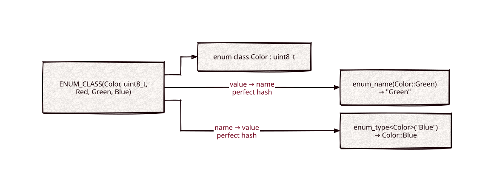

# enum-reflection

[](https://github.com/Kronuz/enum-reflection/actions/workflows/ci.yml)
[](LICENSE)


Reflective enums for C++20: one macro defines a real `enum class` and
`constexpr` lookups from each member to its name and back, through compile-time
perfect hashes. For printing, parsing, and configuring enums without
hand-written tables.



## ✨ Highlights

- **A real `enum class`**, with its underlying type and explicit values, sparse or
  not.
- **Both directions.** `enum_name(Color::Green)` is `"Green"`;
  `enum_type<Color>("Blue")` is `Color::Blue`.
- **All `constexpr`.** Lookups work in `static_assert`, with no runtime table
  building and no heap.
- **Perfect-hash dispatch** through [constexpr-phf](https://github.com/Kronuz/constexpr-phf)
  and [hashes](https://github.com/Kronuz/hashes): no string scans.

## 📦 Installation

Requires a C++20 compiler and CMake 3.14 or newer; it fetches constexpr-phf and
hashes (which bring static-string and char-classify). CI builds it on Linux
(x86_64, arm64), macOS (arm64, x86_64), and FreeBSD, plus ASan, UBSan, and TSan
builds.

```cmake
include(FetchContent)
FetchContent_Declare(enum_reflection
  GIT_REPOSITORY https://github.com/Kronuz/enum-reflection.git
  GIT_TAG        main)
FetchContent_MakeAvailable(enum_reflection)

target_link_libraries(my_app PRIVATE enum_reflection::enum_reflection)
```

## 🚀 Quick start

```cpp
#include "enum.h"

#include <cstdint>

ENUM_CLASS(Status, std::uint16_t,
	Ok = 200,
	NotFound = 404,
	Teapot = 418
)

static_assert(enum_name(Status::NotFound) == "NotFound");
static_assert(enum_type<Status>("Teapot") == Status::Teapot);

int main() {}
```

An unknown name makes `enum_type` throw `std::out_of_range`; an undefined value
gives `enum_name` an empty string. [`examples/demo.cc`](examples/demo.cc) walks
every member of an enum without naming one.

## 🎯 When to use it

- ✅ Enums that appear in text: configuration, protocols, logs, command lines.
- ❌ Enums with very many members: the macro expands per member, which costs
  compile time.

## 📚 Documentation

- [docs/API.md](docs/API.md): `ENUM_CLASS`, `ENUM`, and the accessors.
- [ARCHITECTURE.md](ARCHITECTURE.md): the preprocessor map and the two perfect
  hashes.
- [AGENTS.md](AGENTS.md): repository map, invariants, and traps.

## 🛠️ Building and testing

```sh
cmake -B build && cmake --build build && ctest --test-dir build
./build/enum_reflection_demo
```

## 🤝 Contributing

Issues and pull requests are welcome. Read [AGENTS.md](AGENTS.md) first. CI must
pass on every platform.

## 📄 License

MIT, Copyright (c) 2015-2019 Dubalu LLC; `enum.h` carries portions Copyright (c)
2012-2019 Anton Bachin. See [LICENSE](LICENSE). Extracted from
[Xapiand](https://github.com/Kronuz/Xapiand).
